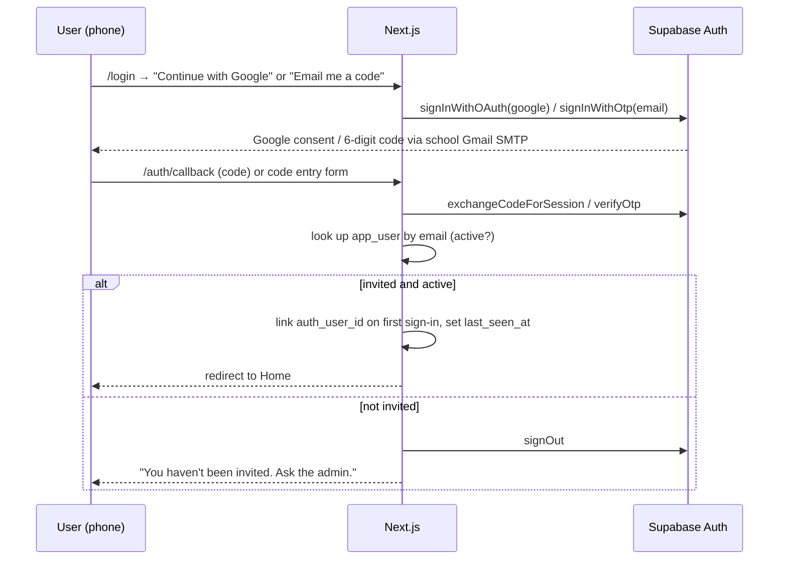

# 03 — Authentication and Access

## Sign-in (D3)

Two phases:
- **Until go-live: email + password.** The admin creates each account in *Settings → Users* with a temporary password (Supabase admin API, server-side, service-role key) and shares it with the person, who changes it after signing in (*Account → Change password*). Self sign-up is disabled in Supabase. No email is sent, so no SMTP is needed.
- **At go-live (M9-04): Google sign-in and email codes are added.** Password sign-in stays as a fallback. The flow below shows the go-live state.

- **Invite-only:** `app_user.email` is the allowlist. The admin adds a user in *Settings → Users*, which creates both the `app_user` row and the Supabase auth account. No invitation email is sent.
- **Session:** cookie-based via `@supabase/ssr`. `middleware.ts` refreshes the session and redirects signed-out requests to `/login`, except for `/login`, `/auth/*`, `/manifest.webmanifest` and static assets.
- **`requireUser()`** (`src/server/auth/session.ts`) returns the `SessionUser { id, name, email, role }` from `app_user`. It's memoised per request with React `cache`. A user who is deactivated mid-session is signed out on their next request.
- **Bootstrap:** the first admin's `app_user` row comes from `BOOTSTRAP_ADMIN_EMAIL` ([02-schema seeds](02-schema.md#seeds)); their auth account is created by hand in the Supabase dashboard (H2).
- **Test auth mode:** when `AUTH_MODE=test`, `/login` shows a "sign in as …" list of seeded users and sets a cookie holding the chosen `app_user.id`, which `requireUser()` revalidates against the database on every request. `src/lib/env.ts` **refuses to start** if `AUTH_MODE=test` on any Vercel deployment (`VERCEL_ENV` is set), because previews share the production database (D30). This mode is used only by Playwright and local demos.

## Roles

| Role | Who |
|---|---|
| `admin` | Runs the system: users, settings, fees, everything |
| `management` | Trustees: read-only across everything, reports |
| `coordinator` | Academic / gurukula coordinators: manage child records, admissions, duties, concerns |
| `teacher` | Teachers and mentors: observe, follow up, assessments |

## Permission matrix

Lives in `src/server/auth/permissions.ts` as data. A unit test asserts it matches this table.

| Action | admin | management | coordinator | teacher |
|---|:-:|:-:|:-:|:-:|
| `child.read` | ✓ | ✓ | ✓ | ✓ |
| `child.write` (profile, family, enrolment, education history) | ✓ | | ✓ | |
| `child.import` | ✓ | | | |
| `entry.create` | ✓ | | ✓ | ✓ |
| `entry.edit_own` | ✓ | | ✓ | ✓ |
| `entry.edit_any` / `entry.delete_any` | ✓ | | ✓ | |
| `entry.close_follow_up` | ✓ | | ✓ | ✓ |
| `restricted.read` (health entries, restricted docs, full health profile) | ✓ | ✓ | ✓ | |
| `health.write` | ✓ | | ✓ | |
| `document.upload` | ✓ | | ✓ | ✓ (non-restricted kinds) |
| `admission.read` | ✓ | ✓ | ✓ | |
| `admission.write` | ✓ | | ✓ | |
| `duty.read` | ✓ | ✓ | ✓ | ✓ |
| `duty.write` | ✓ | | ✓ | |
| `assessment.read` | ✓ | ✓ | ✓ | ✓ |
| `assessment.write` | ✓ | | ✓ | ✓ |
| `fee.read` | ✓ | ✓ | ✓ | |
| `fee.write` | ✓ | | | |
| `report.read` (all reports) | ✓ | ✓ | ✓ | |
| `report.attention` (needs attention) | ✓ | ✓ | ✓ | ✓ |
| `alumni.write` | ✓ | | ✓ | |
| `feedback.create` | ✓ | ✓ | ✓ | ✓ |
| `feedback.triage` | ✓ | | | |
| `settings.manage` (users, lists, preferences) | ✓ | | | |
| `audit.read` | ✓ | | | |

### Rules beyond the matrix

- **Restricted data (D13):** every query that returns entries or documents filters `visibility = 'restricted'` and `restricted = true` unless `can(user, 'restricted.read')`. `health_profile.medical_alerts` is always returned; the other health fields only with `restricted.read`. This filtering is done **in the query**, not in the UI.
- **Own entries:** `entry.edit_own` allows editing `note`, tags, `details` and `follow_up_on` when `author_id = user.id`. Authors can soft-delete their own entries for 24 hours; after that only `entry.delete_any` can.
- **Closing:** anyone with `entry.close_follow_up` can close any open entry. `closed_by` records who.
- **Consent gate:** moving a child to `student` requires `consent_given_at` (enforced in the server action).
- **UI mirrors the server:** hide actions the user can't perform (`can()` is importable on the client via a serialisable role), but the server check is the one that counts.

## Testing requirements

- Unit: matrix snapshot; `can()` for every role × action.
- DB/integration: a teacher's query never returns restricted entries or documents; medical alerts are visible to the teacher.
- E2E: a teacher has no Fees tab or Admissions menu; management cannot see edit buttons.
