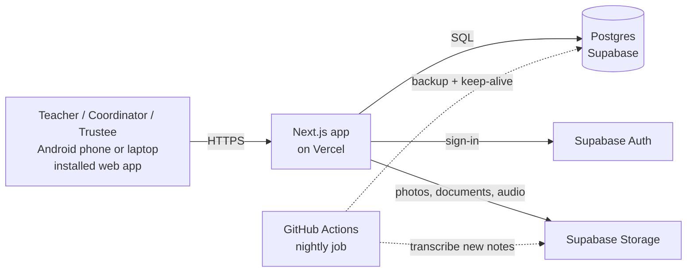
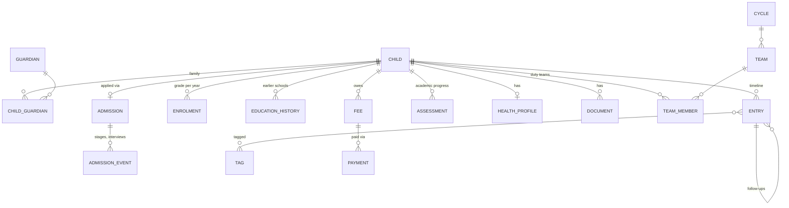

# Bāla Pālana — Design Doc

Status: Draft · Companion to [idea.md](idea.md) · Detailed specs in [architecture/](architecture/) · Decisions are referenced as D*n* (§10)

## 1. Goals and non-goals

**Goals**
- One lifelong record per child, from enquiry to alumna, viewable as a year-by-year journey.
- Observations in under 15 seconds on an Android phone, with follow-ups that don't get lost.
- Instant answers to "who needs attention?" and "who was on duty that day?"
- **₹0 to run**, low maintenance, adaptable through settings rather than code changes.

**Non-goals (v1):** see *Out of scope* in [idea.md](idea.md).

## 2. Architecture

| Layer | Choice | Why |
|---|---|---|
| App | **Next.js (App Router) + TypeScript**, installable as a **PWA** (Progressive Web App: a website that installs to the home screen and opens like an app) | One codebase for phone and desktop; no app store (D4) |
| UI | Tailwind + shadcn/ui; Recharts for charts | Fast to build, mobile-first |
| Database | **Postgres on Supabase** (Mumbai region) | Relational data, strong reporting queries, free tier, data stays in India |
| ORM | Drizzle | Type-safe; plain SQL migrations |
| Validation | Zod | One schema per entry category, shared by forms and server (D6) |
| Auth | Supabase Auth: **email + password** to start; **Google sign-in** and email codes added at go-live (D3) | No passwords and no paid email service (D3) |
| Files | Supabase Storage (private buckets) | Photos, documents, voice notes (D16) |
| Jobs | **GitHub Actions** nightly | Backups, keep-alive, transcription with **faster-whisper** (D14) |

All database access happens **server-side only** (server actions or route handlers). Postgres row-level security (RLS: rules inside the database that limit which rows each user can see) is a second line of defence.

## 3. Domain model

### 3.1 Core ideas

1. **One child, one record, for life** (D5). `child.stage` moves `applicant → student → alumna` (or `not_admitted` / `withdrawn`). Admission history stays attached when she joins.
2. **The timeline entry is the backbone** (D6). Observations, concerns, corrective actions, follow-ups, health notes, skills, achievements, responsibilities and alumni interactions are all `entry` rows with a category, tags and optional category-specific `details`. That gives one journey view, one follow-up system and one reporting surface.
3. **Structured tables only where reports need structure**: admissions, enrolment per year, assessments, duty rotation, fees, documents.
4. **Every list is configurable** (D7): stages, categories, tags, subjects, terms, duties, document kinds and so on live in one `lookup` table, seeded with defaults and editable by the admin.

### 3.2 Entity diagram

### 3.3 Tables

Full column-level schema, constraints, views and seed data: **[architecture/02-schema.md](architecture/02-schema.md)**. Duties, subjects, tags, grades and the other configurable lists are rows in the `lookup` table, not separate tables (D7).

### 3.4 Entry categories (default seed)

| Category | Category-specific `details` | Default visibility |
|---|---|---|
| Observation | — | staff |
| Concern / needs help | subject? | staff (opens a follow-up) |
| Corrective action | linked concern (`parent_id`) | staff |
| Academic | subject, term? | staff |
| Skill / talent / interest | area (music, dance, art, sport, chanting, …) | staff |
| Achievement / competition | event, level (gurukula → international), result, certificate document? | staff |
| Responsibility held | role title, from, to | staff |
| Health / well-being | — | **restricted** |
| Alumni interaction | mode (call, visit, event) | staff |

### 3.5 Key queries

- **On duty X on date D:** the `cycle` containing D → `team` for X → `team_member` where D falls in the member's dates (default: the whole cycle).
- **How often she did duty X:** count `team_member` rows for her, on teams for X, in the period.
- **Needs attention:** open concerns; follow-ups due or overdue; children with no entry in *N* days (N is a setting, default 30); children with concerns in two or more subjects.
- **Journey:** all of her entries, assessments, enrolments, admission events and duty history, merged and grouped by academic year.

## 4. Key screens

Home (my follow-ups), quick observation, children list, child profile with a journey timeline and tabs, follow-ups, needs attention, duty board, academics bulk entry, admissions board, alumni, reports, feedback and settings. Full spec: **[architecture/04-ui-spec.md](architecture/04-ui-spec.md)**.

## 5. Access control

Four roles (admin, management, coordinator, teacher), enforced server-side with a permission matrix; health data and sensitive documents are restricted (D13). Full matrix and rules: **[architecture/03-auth-and-access.md](architecture/03-auth-and-access.md)**.

## 6. Privacy and data protection

The system holds **children's personal data, including health data**. India's DPDP Act 2023 (Digital Personal Data Protection Act) requires verifiable parental consent before processing a child's data, and forbids tracking or targeted advertising aimed at children.

- Record each child's guardian consent (`child.consent_given_at`); block creating a student without it (admission enquiries are allowed).
- Restricted visibility for health entries and sensitive documents (D13).
- Data hosted in India (Supabase Mumbai region); encrypted at rest and in transit by the providers.
- Invite-only accounts; every write goes to `audit_log`.
- Nightly encrypted backups (D14); the admin can export everything.
- Retention: alumni records stay until the family asks for removal; removal anonymises the record but keeps aggregate statistics.

## 7. Reports

All reports are SQL views shown as tables and charts, with **CSV export** and a print layout (**Save as PDF** from the phone's or browser's print dialog) (D21).

| Report | Contents |
|---|---|
| Child journey | Year-by-year timeline, assessments trend, achievements, duties, open items |
| Needs attention | §3.5 query, filterable by grade or teacher |
| Grade / group summary | Per-subject assessment averages by term, concerns raised and closed, achievements |
| Trends | Year-on-year: assessments, concerns, achievements by level, duty participation |
| Achievements & participation | By year, level, area and child |
| Admissions funnel | Count by stage, conversion rate, follow-ups due |

## 8. Milestones

See [roadmap.md](roadmap.md).

## 9. Alternatives considered

- **Off-the-shelf open-source school systems** (Gibbon, openSIS, RosarioSIS): strong on timetables and grading, which we don't need, and weak on the journey timeline, admissions-to-alumni lifecycle and rotating duty teams, which we do.
- **Spreadsheets / Google Forms**: can't give a per-child journey view, enforce access rules, or answer history queries reliably.
- **Native Android app**: the Play Store charges a one-time registration fee and adds a release process; a PWA installs from the browser at no cost.
- **Separate backend + SPA (single-page app)**: more moving parts and more hosting for no benefit at this scale.

## 10. Decisions

Rule of thumb: **when the gurukula's practice varies or is unknown, pick a sensible default and make it configurable.**

| # | Decision | Rationale |
|---|---|---|
| D1 | **₹0 stack, permanently**: free tiers and open-source tools only (§11) | Non-profit, volunteer-built |
| D2 | **English UI in v1**; all data fields accept any script; UI text kept in one file | Translation can be added later without rewriting screens |
| D3 | **Two-phase sign-in.** Until go-live: **email + password**, with accounts created by the admin (self sign-up off). At go-live (M9): add **Google sign-in** and an **email code** sent through a school Gmail account (free SMTP). Sessions last 30 days | Needs no Google or email setup to start building; Supabase's built-in email is too limited for codes (about 2 an hour), and Google sign-in sends no email at all |
| D4 | **PWA, Android-first**; no native app, no Play Store | Free; installs to the home screen; one codebase for phone and desktop |
| D5 | **One `child` record across the lifecycle**, using a `stage` field | The requirements say admission data must stay with the child after she joins |
| D6 | **Timeline entries as the backbone**; category-specific fields in `details` (jsonb, a JSON column in Postgres), validated by one Zod schema per category | One timeline, one follow-up system, one reporting surface; new plain categories need no code |
| D7 | **Every list is a lookup**, seeded with defaults and editable in Settings | Admission stages, tags, subjects, terms, duties etc. will change; no code release needed |
| D8 | **Cycles auto-generated: 1st–15th and 16th–month end.** The admin can edit dates, split, merge, pause (holidays) or skip a cycle, or change the default rule in Settings | Matches the current 15-day practice while allowing any schedule |
| D9 | **Teams are unconstrained**: any number per duty, any size, zero or more leads; a child can be in several teams; mid-cycle swaps use optional from/to dates on membership | Team counts and sizes vary; history stays accurate when swaps happen |
| D10 | **Assessments accept marks, grade letters or remarks** (any combination) | Works with whatever the outside school's report cards use |
| D11 | **Fees are dues plus any number of payments**; receipts are optional attachments | Covers per-term, per-year and instalment payments |
| D12 | **Nothing is hard-deleted.** Entries are editable by their author, every change is kept in `audit_log`, and removals are soft (`deleted_at`) | A child's history is the product; mistakes must be recoverable |
| D13 | **Health entries and sensitive documents are restricted** to coordinator, management and admin; **medical alerts** (allergies, conditions) are visible to all staff | Need-to-know privacy, but safety-critical facts reach every adult |
| D14 | **One nightly GitHub Actions job** in the private ops repo (D29): encrypted `pg_dump` kept as a 30-day artifact, a database keep-alive ping, and faster-whisper transcription of new voice notes | Supabase Free has no backups and pauses after a week idle; this covers all three for free |
| D15 | **Academic year starts in June** (a setting); timezone Asia/Kolkata | Indian school calendar; configurable if the outside school differs |
| D16 | **Private buckets, short-lived signed links; images compressed on the phone** to about 200 KB before upload; PDFs capped at 5 MB | Children's photos are never public; keeps within the 1 GB storage limit |
| D17 | **Default `*.vercel.app` URL**; a custom domain only if one is donated | ₹0 |
| D18 | **Light testing**: unit tests for the duty, needs-attention and journey queries; one end-to-end smoke test per milestone | Covers the logic that matters without slowing weekly releases |
| D19 | **Online-only** (no offline mode) | Internet at the gurukula is good |
| D20 | **Follow-up reminders in-app** (Home → My follow-ups) in v1; web push notifications later | Simplest first; web push is free on Android when needed |
| D21 | **Reports as SQL views + charts, CSV export, print-to-PDF** | No reporting tool or PDF service to pay for |
| D22 | **Senior children (akkas) are recorded as students, not users**; team leads are marked by `team_member.role` | Matches today's practice; a login for them can be added later |
| D23 | **Group observations**: one action records the same entry for several children (one row per child) | A whole team or grade often gets the same note |
| D24 | **The whole v1 schema is built in M0**; later milestones add only views and functions | Lets several agents build features in parallel without migration clashes |
| D25 | **Authorization lives in the server layer** (permission matrix in code); Postgres RLS is enabled with no policies, so the public API key can read nothing | One place to reason about access; the database is locked down if a key leaks |
| D26 | **Auditing is done by a database trigger**; each write's transaction carries the actor (`set_config('app.user_id')`) | No write can skip the audit log |
| D27 | **Money is stored as integer paise** | No rounding errors |
| D28 | **Migrations run in the Vercel build**, and must be backward compatible | No separate deploy pipeline to maintain |
| D29 | **Public code repo `bharathnr1/bala-palana`; private ops repo `bharathnr1/bala-palana-ops`** for the nightly job, backups and production secrets. Gurukula documents (`docs/inputs/`) are git-ignored | Public CI is free with no minute limits and allows branch protection, but logs and artifacts in a public repo are world-readable, so anything touching real data stays private |
| D30 | **One Supabase project `bala-palana`** for previews and production. Previews never run migrations; test sign-in is blocked on every Vercel deployment; before go-live (M9-05), decide whether previews keep database access | Simpler to run, within the free limits; safe while only fake data exists |

## 11. Free-tier budget

Sized for ~120 children, ~20–30 new admissions a year, ~5 teachers and a few coordinators and trustees.

| Service | Free allowance | Expected use | Headroom |
|---|---|---|---|
| Supabase database | 500 MB | ~25 MB a year (about 25k entries a year) | 10+ years |
| Supabase storage | 1 GB | ~3 MB of documents per child at admission + photos ≈ 400 MB in year 1, then ~100 MB a year; voice notes deleted 90 days after transcription | ~5 years; revisit then |
| Supabase Auth | 50,000 monthly active users | < 20 | Ample |
| Supabase egress | 5 GB / month | Small pages, few users | Ample |
| Vercel Hobby | 100 GB transfer, 1M function calls / month | Far below | Ample |
| GitHub Actions, public code repo (CI) | Unlimited minutes | Every PR | Ample |
| GitHub Actions, private ops repo | 2,000 min / month | ~5 min a night ≈ 150 min | 10× |
| GitHub artifact storage (ops repo) | 500 MB | 30 nightly dumps of a few MB each | Ample |
| Gmail SMTP (fallback login) | ~500 emails / day | A handful | Ample |

**Watch-outs**
- **Vercel Hobby is for non-commercial use only.** An unpaid volunteer building for a non-profit, with no payments or ads, fits that. If Vercel's terms change, the fallback is Cloudflare Pages/Workers, whose free tier allows any use.
- **Supabase pauses projects after a week of inactivity**; the nightly job (D14) prevents this.
- **One Supabase project** is used for everything (D30); the free plan allows a second if previews ever need isolating.
- **Storage is the first limit we'll reach.** Settings shows usage; when it passes 70%, move documents to another free store such as Google Drive.

## 12. Open questions

See [open-questions.md](open-questions.md).
